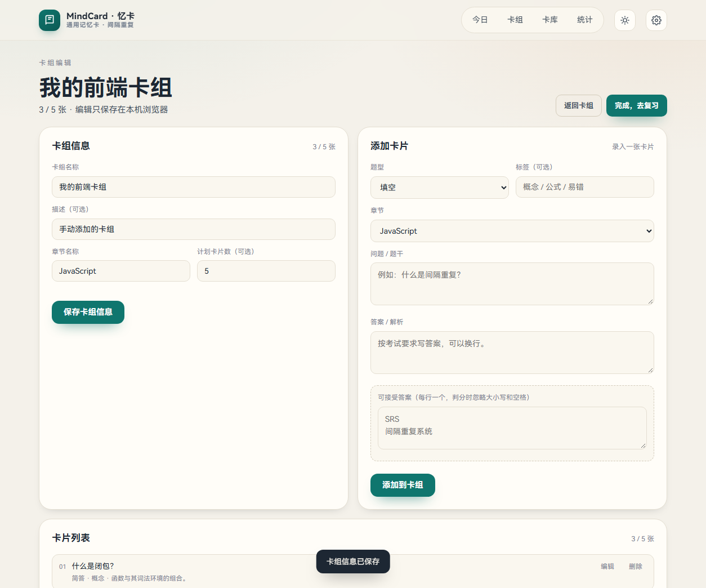

# MindCard · 忆卡

> 把任何笔记变成按遗忘曲线复习的知识卡片。  
> 本地优先、静态部署、卡组可交换。

MindCard 是一个**通用**的间隔重复（SRS）记忆卡平台：卡组是普通 JSON，引擎负责排程，转换器负责把 Markdown / Word / PPT 变成卡片。它不绑定任何学科。

---

## 现在有什么

| 部分 | 状态 | 位置 |
| --- | --- | --- |
| 可运行应用（多卡组） | ✅ v0.2，功能完整 | [`app/`](app/) |
| 卡组格式规范 | ✅ v1 | [`docs/DECK_FORMAT.md`](docs/DECK_FORMAT.md) |
| JSON Schema | ✅ | [`schemas/deck.schema.json`](schemas/deck.schema.json) |
| 卡组校验器 | ✅ | [`tools/validate_deck.py`](tools/validate_deck.py) |
| 文档转换器（MD/TXT/DOCX/PPTX/PDF） | ✅ 规则版 | [`tools/convert.py`](tools/convert.py) |
| 浏览器导入 JSON / Markdown | ✅ v0.3 | 「卡组」页 |
| 卡组编辑器（命名 / 加卡 / 计划数 / 增删改） | ✅ v0.3 | 「卡组」页 → 新建或编辑 |
| 短期/长期卡组（只读冻结 / 导出 / 数量上限） | ✅ | 「卡组」页 → 转为长期 / 导出 |
| 桌面版（Tauri 壳） | 🚧 v0.1 | [`src-tauri/`](src-tauri/) |
| 浏览器解析 DOCX / PPTX | 🚧 v0.4 | 同上 |
| 可选 AI 生成（代理） | 🚧 v1.0 | [`docs/ARCHITECTURE.md`](docs/ARCHITECTURE.md) |

`app/` 现在是一个**通用多卡组应用**：

- 内置示例卡组从 `decks/*.json` 打包而来，切换卡组不会串进度；
- 「卡组」页可以导入 `.json` 卡组、上传 `.md` / `.txt` 现场生成卡片；
- 卡组分短期（网页内可编辑，默认上限 20 个）和长期（只读，导出 JSON 修改后可重新导入）；
- 桌面版用 Tauri 套壳，复用同一套 `app/` 界面，图标取自网页 logo；
- Word / PPT / PDF 先用 `tools/convert.py` 转成卡组 JSON，再导入；
- 旧的单课程进度在导入同名卡组后会自动迁移；

---

## 使用说明

### 1. 架构：内容、引擎、入口、外壳

MindCard 把“卡组内容”和“复习算法”分开，四层各自独立：

| 层 | 主要文件 | 职责 |
| --- | --- | --- |
| 界面层 | `app/index.html`、`styles.css` | 页面骨架、主题、卡片/编辑器/统计视图 |
| 内容层 | `decks/*.json`、浏览器导入的 JSON | 卡组、章节、卡片；不含学习进度 |
| 引擎层 | `app/app.js`、`app/deck-store.js` | SRS 排程、评分、统计、校验、Markdown 解析 |
| 存储层 | `app/storage.js`、`src-tauri/src/storage.rs` | 浏览器 `localStorage` / 桌面磁盘 JSON 适配 |
| 入口层 | `tools/convert.py`、`tools/validate_deck.py` | 把笔记/文档转成卡组，并校验格式 |
| 桌面外壳 | `src-tauri/` | Tauri + WebView2，复用同一套 `app/` 界面 |

学习引擎的默认阶梯是：

```text
10 分钟 → 1 天 → 2 天 → 4 天 → 7 天 → 15 天 → 30 天 → 60 天 → 120 天 → 240 天
```

每次复习按 **忘记 / 模糊 / 记住 / 简单** 评分；忘记会回到短间隔，简单会跳级并提高 ease。进度按卡组 id 和卡片 id 分别记录，所以**发布后不要改卡组 id 或已有卡片 id**。

### 2. 卡组文件到底要什么格式

**卡组文件只认 UTF-8 编码的 `.json`，格式为 Deck Format v1。**  
Markdown/TXT 只是“生成卡组的入口”，不是最终卡组格式。

| 你手里的文件 | 在应用里怎么用 | 结果 |
| --- | --- | --- |
| `.json`（Deck v1） | 「卡组」→「导入 .json 卡组」 | 直接成为可复习卡组 |
| `.md` / `.markdown` / `.txt` | 「卡组」→「用 .md / .txt 生成」 | 浏览器解析、预览，确认后保存为卡组 |
| `.docx` / `.pptx` / `.pdf` | 先运行 `python tools/convert.py` | 生成 `.json` 后再导入 |
| `.json`（设置里的「导出全部备份」） | 「设置」→「导入全部备份」 | 恢复卡组 + 进度 + 回收站 + 设置；**不是**卡组文件 |
| `.doc` / `.xls` / 图片 / 扫描版 PDF | 不直接支持 | 先另存为 DOCX/PPTX/文本，或先做 OCR/整理 |

说明：

- 浏览器导入 `.md/.txt` 时，`Q:/A:`、两列表格、`术语：定义` 会被识别；普通段落默认忽略；
- DOCX/PPTX/PDF 的规则转换只擅长结构化内容，散文式讲义建议先整理成问答；
- 图片题不靠单独图片文件，图片会压缩成 Data URL 内嵌在 JSON 的 `questionImage` / `answerImage` 里；
- 扩展名必须是 `.json`，内容必须是对象；数组、HTML、压缩包都不行。

### 3. 最小卡组 JSON

```json
{
  "schemaVersion": 1,
  "id": "my-deck",
  "title": "我的卡组",
  "chapters": [
    { "id": "ch-01", "name": "第 1 章 基础" }
  ],
  "cards": [
    {
      "id": "c-0001",
      "chapter": "ch-01",
      "type": "recall",
      "question": "什么是间隔重复？",
      "answer": "在即将遗忘之前安排下一次复习，并逐渐拉长间隔。"
    }
  ]
}
```

顶层必填：

| 字段 | 要求 |
| --- | --- |
| `schemaVersion` | 固定 `1` |
| `id` | 2–64 位，小写字母/数字/短横线，发布后不要改 |
| `title` | 卡组标题 |
| `chapters` | 至少 1 个；`id` 以 `ch-` 开头，`name` 必填 |
| `cards` | 至少 1 张；`id`、`chapter`、`type` 必填 |

卡片公共规则：

- `question` / `answer` 至少各有一个非空，或分别用 `questionImage` / `answerImage` 代替；
- `chapter` 必须引用存在的章节 `id`；
- `type` 为 `recall` / `cloze` / `choice` / `judge` / `code`；
- 可选 `tag`、`hint`、`explanation`、`source`；
- 不要写 HTML；答案支持极简 Markdown（加粗、换行、行内代码、代码围栏）。

各题型额外要求：

| 题型 | 额外字段 |
| --- | --- |
| `recall` 简答 | 无；题干 + 答案即可 |
| `cloze` 填空 | 题干用 `____` 标空；`accept` 至少 1 个可接受答案 |
| `choice` 选择 | `options` 2–8 项；`answerIndex` 从 0 开始；仍需 `answer` |
| `judge` 判断 | `correct: true/false`；仍需 `answer` |
| `code` 代码/计算 | 可选 `pre` 放题干代码；`answer` 放参考代码/步骤 |

完整字段和 JSON Schema：

- [`docs/DECK_FORMAT.md`](docs/DECK_FORMAT.md)
- [`schemas/deck.schema.json`](schemas/deck.schema.json)
- 校验：`python tools/validate_deck.py decks/my-deck.json`

### 4. 用户可以怎么自行设计卡组

**方式 A：在应用里直接建（适合边学边加）**

1. 打开「卡组」，点「短期卡组」右侧的「+」，填名称；
2. 进入编辑器，选题型，填问题/答案；只放图片也可以保存；选择题补选项，填空题补可接受答案；
3. 题干或答案可以只放图片，支持上传或直接粘贴截图；只放图片时，填空/选择若缺少可接受答案或选项，会自动按简答自评卡保存；
4. 可连续添加任意多张，随时改名、改章节、删卡、搜索；
5. 点「完成，去复习」开始。

短期卡组默认最多 20 个，可在设置里改为 1–20；转为长期后只读，导出 JSON 修改后可重新导入。

**方式 B：自己写 JSON（适合批量整理、版本管理、分享）**

1. 复制上面的最小 JSON；
2. 改 `id`、`title`、章节；
3. 按“一张卡只考一个点”拆卡片；
4. 用 `python tools/validate_deck.py` 校验；
5. 在「卡组」→「导入 .json 卡组」导入。

**方式 C：Markdown 批量生成**

```markdown
# 我的卡组

## 第 1 章 基础

Q: 什么是间隔重复？
A: 在即将遗忘之前安排下一次复习。

| 术语 | 定义 |
| --- | --- |
| SRS | 间隔重复系统 |
```

保存为 `.md`，在浏览器里导入，或运行：

```bash
python tools/convert.py notes.md -o decks/my-deck.json --id my-deck --title "我的卡组"
```

设计卡组时建议：

- 一张卡只问一个概念，题干不依赖上一张卡；
- 答案先给结论，再给一句原因/例子；
- 一个章节控制在 5–15 张，避免一次复习过载；
- 卡片 id 用 `c-0001` 这类稳定编号，已发布的不要改；
- 图片先压缩，尽量一个卡组控制在 10–20 张图；
- 公开别人整理的卡组前，确认教材/课件/图片的授权，并在 `license` 里写清楚。

### 5. 数据、备份与桌面版

- 卡组内容、学习进度、设置默认都在本机，不会上传服务器；
- **浏览器版**使用当前站点的 `localStorage`；
- **桌面版**启动时把数据载入 WebView，保存时同步写入应用数据目录的 `storage/`（Windows 默认 `%LOCALAPPDATA%\com.mindcard.desktop\storage`），每张卡组/进度一个 JSON 文件；
- 桌面版首次启动会把旧的 WebView `localStorage` 数据自动迁移到磁盘，之后以磁盘为准；
- 换浏览器、无痕模式、清理站点数据、换访问域名，都可能看不到原来的进度；桌面版清理应用数据目录也会丢失进度；
- 「设置 → 导出全部备份」会打包卡组、进度、回收站和设置；换电脑时用「导入全部备份」恢复；
- 便携包解压后运行 `MindCard.exe`，必须保留同目录的 `WebView2Loader.dll`；数据仍写入系统应用数据目录，不写便携包目录。

### 6. 发布前安全与隐私

当前代码：

- **不需要任何模型 API key**，也没有调用任何云模型服务；
- 没有把 AI 工具、对话记录或本地绝对路径写进业务代码；
- `app/` 页面没有遥测、没有把学习记录上传到服务器。

公开源码前仍建议做一次检查：

```bash
# 不应出现在待提交内容里
git status --ignored
grep -RInE "sk-[A-Za-z0-9_-]{16,}|api[_-]?key|Authorization: Bearer" \
  --exclude-dir=.git --exclude-dir=dist --exclude-dir=target .

# 不应提交的目录
# .env  .env.*  *.log  dist/  src-tauri/target/  private/
```

注意：

- **不要提交** `dist/`、`src-tauri/target/`、`*.log`、`.env*`、`private/`；
- **不要提交** AI 工具/编辑器自己的对话日志、缓存或导出文件；
- `src-tauri/target/` 里的构建元数据可能包含本机 Rust 路径，虽然已在 `.gitignore`，也不要手动打包；
- 如果以后接入 AI，API key 只能放服务端/环境变量，不能写进前端 JS 或仓库；
- 如果公开的是**已有 Git 历史的仓库**，要额外检查历史提交；当前工作目录还没有初始化 Git，首次提交是干净的。

---

## 公开仓库 vs 本地私有

| 位置 | 是否提交 | 内容 |
| --- | --- | --- |
| `app/`、`decks/`、`docs/`、`tools/` | ✅ 提交 | 公开网站 + 示例卡组 + 工具 |
| `../MindCard-private/` | ❌ 在仓库外 | 你的课程卡组、导出的进度备份 |
| 同级目录 `../记忆复习软件/` | 在仓库外 | 旧单课程应用，浏览器里保留原有进度 |

当前配置下，公开网站只包含 **示例卡组**；你的《微机原理》卡组在仓库外的 `../MindCard-private/microcomputer-stc15.json`，不会进 Git、不会进 Pages。想使用时，在网页里手动导入即可。

---

## 数据在哪里？别人打开会看到什么？

| 数据 | 存在哪里 | 别人打开网页能看到吗 |
| --- | --- | --- |
| 公开卡组（`decks/*.json`） | 打包进 `app/decks.js`，随网页发布 | ✅ 能看到，也能下载 |
| 你导入的本地私有卡组 | 当前浏览器的 `localStorage` | ❌ 看不到，只在你本机 |
| 学习进度 / 连续打卡 | 当前浏览器，按卡组分别保存 | ❌ 看不到 |
| 桌面版卡组/进度 | 应用数据目录 `storage/*.json`（默认 `%LOCALAPPDATA%\com.mindcard.desktop\storage`） | ❌ 只在本机 |
| 桌面版设置 | 同一数据目录下的 `mindcard:settings` 文件 | ❌ 只在本机 |
| 设置（主题、考试日期等） | 当前浏览器 | ❌ 看不到 |
| 你导出的 JSON | 你的下载文件夹 | ❌ 除非你主动发给别人 |

所以：

- **别人打开你部署的 GitHub Pages**：看到的是示例卡组 + 一个全新的空进度；他自己导入的卡组和进度只存在他的浏览器里，不会回传给你。
- **你把 `app/` 文件夹发给别人**：同上，公开卡组跟着文件走；他的学习记录只在他的电脑上。
- **你换浏览器 / 无痕模式 / 清理浏览器数据 / 换访问域名**：本地导入的卡组和进度都会看不到。

想让别人用你整理的卡组，有两种方式：

1. **公开发布**：把卡组 JSON 放进 `decks/`，在 `decks/index.json` 注册，运行 `python tools/build_app_decks.py`，推送后所有访问者都能看到；
2. **私下分享**：把导出的卡组 JSON 发给对方，让对方在「卡组 → 导入 .json 卡组」里导入。

> ⚠️ 公开卡组是**公开内容**：一旦部署，任何人都能查看源码和 `decks.js`。当前公开仓库只含自写的示例卡组；课程卡组在仓库外的 `../MindCard-private/`，只要不主动移到 `decks/` 就不会公开。

---

## 数据安全与备份

- **图片题**：上传/粘贴的图片会压缩后内嵌到卡组 JSON；图片多时卡组会明显变大，建议一个卡组控制在 10–20 张图以内。
- **一卡组一键**：`mindcard:deck:<id>`，不再把所有卡组塞进一个 JSON；单个卡组损坏不会拖垮全部。
- **自动备份**：进度每次保存会保留上一版本（`mindcard:progress:<id>:bak`，每分钟最多一份）；主数据损坏会自动尝试恢复。
- **导出全部**：设置 → 导出全部备份，包含卡组、进度、卡组回收站和主题设置。
- **导入全部**：设置 → 导入全部备份，可整体迁移到新电脑。
- **回收站**：删除卡片/卡组会先放回收站，可恢复；彻底删除才会清理进度。
- **保存失败提示**：隐私模式、配额满、存储不可用时会显示横幅，提醒立即导出，不再静默丢数据。
- **多标签页**：另一个标签页修改数据时会提示刷新，避免互相覆盖。

---

## 快速开始

### 1. 直接体验

双击 `app/index.html`，或用任意静态服务器打开：

```bash
python -m http.server 8000
# 打开 http://localhost:8000/app/
```

### 1.1 单文件版（一个 HTML 直接分享）

```powershell
python tools/build_single_file.py
# 生成 app/MindCard.html
```

- 已内联 CSS、`decks.js`、`deck-store.js`、`app.js`；
- 不需要服务器，双击即可打开；
- 默认只包含公开示例卡组，适合发给别人；
- 代码更新后需要重新运行一次。

课程内容可以生成到仓库外，避免进 Git：

```powershell
python tools/build_single_file.py `
  --deck ..\MindCard-private\microcomputer-stc15.json `
  --out ..\MindCard-private\MindCard_课程单文件版.html
```

这个文件包含课程卡组，**不要提交到公开仓库**。  
单文件版和 `app/index.html` 的 localStorage 是否共享取决于打开方式（同一 HTTP origin 才共享）；需要迁移时用导出/导入。

### 1.2 桌面版（Tauri）

第一版是 Tauri 壳，复用 `app/` 界面，原生标题栏；当前交付 exe/便携包，NSIS 安装包需网络下载 NSIS 后生成。

环境：Rust + WebView2 + Node；本机用 GNU 工具链验证，正式发布建议 MSVC Build Tools。

```powershell
cd MindCard
.\tools\build_desktop.ps1            # 只编译 exe
.\tools\build_desktop.ps1 -Bundle    # 生成安装包
```

脚本会自动把源码复制到 ASCII 暂存目录（中文路径会让 MinGW `windres`/`ld` 失败），设置 Rust/MinGW 环境，并把产物复制到 `dist/`：

```text
dist/MindCard.exe
dist/MindCard-0.1.0-portable.zip   # 解压即用，含 exe + WebView2Loader.dll + README
dist/MindCard-setup.exe             # -Bundle 且 NSIS 下载成功时
```

当前环境访问 GitHub 下载 NSIS 超时，只生成了 exe 和便携包；网络恢复后运行 `-Bundle` 可补安装包。
便携包解压后必须保持 `MindCard.exe` 与 `WebView2Loader.dll` 在同一目录。

发布 exe 前建议用当前 `build_desktop.ps1` 重新构建一次：脚本已加入 `--remap-path-prefix`，避免 Rust 依赖的 panic 信息把本机用户名/绝对路径写进二进制。

图标来源：`app/index.html` 的内联线稿 SVG + `app/styles.css` 的圆角渐变底色，已提取为
`src-tauri/icons/source.svg`，并用 `tauri icon` 生成 `.ico/.icns/PNG`。

桌面版已切换到应用数据目录的磁盘存储，浏览器版继续使用 `localStorage`；详见
[`docs/TAURI_APP.md`](docs/TAURI_APP.md)。构建和排查流程见
[`docs/WORKFLOW_ANTI_LOOP.md`](docs/WORKFLOW_ANTI_LOOP.md)。

### 1.3 Windows 提示“已保护你的电脑”

这是 SmartScreen 对**未签名、每次重新构建后哈希都变化**的 exe 的常规提示，不是卡组或代码出错。

自己使用：

1. 解压后运行，不要直接在 zip 里双击；
2. 点“更多信息 → 仍要运行”；
3. 或先执行 `Unblock-File .\MindCard.exe`，去掉“来自其他计算机”的锁定。

发给别人：

- 临时办法仍是让对方“更多信息 → 仍要运行”；
- 长期方案是申请受信任的代码签名证书（OV/EV/Azure Trusted Signing），签 exe 和安装包；
- 自签名证书只适合本机，别人不会自动信任；
- 不建议全局关闭 SmartScreen 或 Defender。

详细原因、命令和签名方案见 [`docs/WINDOWS_SMARTSCREEN.md`](docs/WINDOWS_SMARTSCREEN.md)。

### 2. 在浏览器里导入（不用命令行）

打开应用 → 顶部 **「卡组」**：

- **导入 .json 卡组**：直接选别人分享的卡组；
- **用 .md / .txt 生成**：上传笔记，预览识别出的卡片，确认后保存并开始。

Markdown 支持：`Q:` / `A:`、两列表格、`术语：定义`。Word / PPT / PDF 请用下面的命令行工具转换。

### 3. 从零新建卡组、手动加卡片

1. 「卡组」页 → 短期卡组标题右侧的「+」：填名称（必填）、计划卡片数（仅展示）、描述；
2. 点「创建并添加卡片」，进入编辑器；
3. 选题型（简答 / 填空 / 选择 / 判断 / 代码），填问题与答案，按题型补选项或可接受答案；
4. 点「添加到卡组」，可连续添加任意多张，顶部会显示已添加数量；题干和答案都可以只放图片，支持上传或直接粘贴截图；
5. 在「卡组信息」里可以随时改名、改章节名、改计划卡片数；
6. 卡片列表支持逐张「编辑」「删除」，也支持搜索和题型筛选；
7. 点「完成，去复习」回到今日复习。

内置卡组不能直接改，点「复制为短期卡组」会生成可编辑副本。



### 短期卡组与长期卡组

| | 短期卡组 | 长期卡组 |
| --- | --- | --- |
| 网页内编辑 | ✅ 可加卡、改卡、删卡、改名 | ❌ 只读 |
| 数量限制 | ✅ 默认 20 个，可在设置里改（1–20） | 不占短期名额 |
| 复习 / 统计 | ✅ | ✅ |
| 导出到电脑 | ✅ | ✅ |
| 修改方式 | 直接在网页改 | 导出 JSON 编辑后重新导入，或另存为短期副本 |

- **短期 → 长期**：卡组卡片或编辑器里的「转为长期」；确认后立即变只读，名额释放。
- **长期修改**：先「导出」得到 `.json`，用文本编辑器改完，再「导入 .json 卡组」。导入默认成为短期卡组，可继续在网页里改。
- **长期只读**：没有编辑按钮，卡库里的「删除」也隐藏；防止误改。
- **导出全部**：卡组页顶部或设置页的「导出全部」，会把卡组、进度、回收站和设置打包。

### 4. 用命令行把自己的笔记变成卡组

准备一个 Markdown 文件：

```markdown
# 我的卡组

## 第 1 章 基础

Q: 什么是间隔重复？
A: 在即将遗忘之前安排下一次复习。

- 主动回忆：先合上答案自己回想，再翻看核对。

| 术语 | 定义 |
| --- | --- |
| SRS | 间隔重复系统 |
```

转换并校验：

```bash
pip install -r tools/requirements.txt

python tools/convert.py notes.md -o decks/my-deck.json --id my-deck --title "我的卡组"
python tools/validate_deck.py decks/my-deck.json
```

`decks/my-deck.json` 就是可以分发的卡组。

### 5. 从 Word / PPT 转换

```bash
python tools/convert.py 我的笔记.docx -o decks/notes.json --mode outline
python tools/convert.py 课件.pptx -o decks/slides.json
```

> 规则转换只擅长“结构化内容”：问答对、两列表格、`术语：定义`。  
> 散文式讲义建议先整理成问答，或等 v1.0 的 AI 代理。

---

## 仓库结构

```
MindCard/
├─ app/                 # 多卡组应用（可直接部署）
│  ├─ index.html
│  ├─ app.js            # SRS、视图、统计、导入交互
│  ├─ deck-store.js     # 卡组加载、校验、Markdown 解析
│  ├─ decks.js          # 内置卡组（由 build_app_decks.py 生成）
│  ├─ MindCard.html     # 单文件版（由 build_single_file.py 生成）
│  └─ styles.css
├─ src-tauri/           # Tauri 桌面壳
│  ├─ tauri.conf.json   # 窗口、图标、打包配置
│  ├─ Cargo.toml
│  ├─ icons/            # 从网页 logo 生成的图标
│  └─ src/main.rs
├─ decks/               # 公开卡组源文件与注册表
│  ├─ index.json
│  └─ example-study-notes.json
├─ examples/            # 支持写法的示例 Markdown
├─ schemas/             # deck JSON Schema
├─ tools/               # 转换器、校验器、内置卡组打包
├─ docs/                # 架构、格式说明
├─ .github/workflows/   # CI 校验 + Pages 部署
├─ LICENSE
└─ README.md
```

私有内容放在仓库外：

```
MindCard-Workspace/
├─ MindCard/            # 公开仓库
├─ MindCard-private/    # 课程卡组、进度备份（不进入 Git）
│  ├─ microcomputer-stc15.json
│  └─ README.md
└─ 记忆复习软件/          # 旧版单课程应用（保留作迁移来源）
```

---

## 架构一句话

**卡组是内容，引擎是算法，转换器是入口，静态站点是分发方式。**

```
文件 → Extractor → Document IR → Segmenter → Generator → Validator → deck.json
                                                              ↓
                                                       学习引擎（SRS）
```

完整设计（分层、存储、导入流水线、AI 形态、路线图）见 [`docs/ARCHITECTURE.md`](docs/ARCHITECTURE.md)。

---

## 部署到 GitHub Pages

1. 新建仓库，把本目录推上去；
2. Settings → Pages → Source 选 **GitHub Actions**；
3. 已包含 [`.github/workflows/pages.yml`](.github/workflows/pages.yml)，会把 `app/` 发布为站点根目录；
4. 推送 `main` 后访问 `https://<你的用户名>.github.io/<仓库名>/`。

也可以手动把 `app/` 目录部署到任意静态托管（Netlify、Vercel、Cloudflare Pages）。

---

## 贡献卡组

1. 新增 `decks/<id>.json`，按 [`docs/DECK_FORMAT.md`](docs/DECK_FORMAT.md) 编写；
2. 在 `decks/index.json` 注册；
3. 本地跑 `python tools/validate_deck.py decks/<id>.json`；
4. 运行 `python tools/build_app_decks.py`，把内置卡组重新打包进 `app/decks.js`；
5. 提交 PR，并在 PR 里说明来源与许可证。

CI 会校验 JSON 结构、章节引用、id 唯一性和重复题目。

> **版权提醒**：公开仓库只包含自写的示例卡组 `example-study-notes.json`（CC-BY-4.0）。课程卡组放在仓库外的 `../MindCard-private/`，不会提交或发布。如果你以后决定公开自己的卡组，请先确认课件/教材授权。

---

## 路线图

- **v0.2 ✅** 通用引擎：多卡组、卡组切换、按卡组隔离进度、导入 JSON
- **v0.3 ✅** 浏览器内 Markdown/TXT 导入 + 预览 + 卡组编辑器（命名 / 加卡 / 计划数）
- **v0.4** DOCX/PPTX 浏览器解析、PWA 离线、卡组在线注册表
- **v1.0** 可选 AI 代理、PDF/OCR、i18n、多卡组备份包

---

## License

代码：[MIT](LICENSE)。  
卡组：见各卡组的 `license` 字段。
