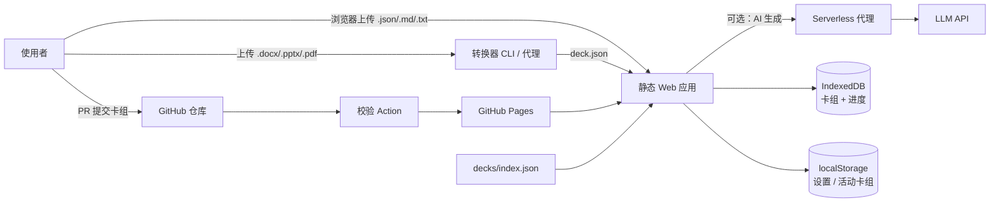
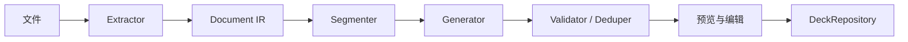

# MindCard 架构设计

> 一个与具体课程无关的、本地优先的间隔重复记忆卡平台。  
> 核心思想：**内容（Deck）与引擎（Engine）分离，解析（Extract）与生成（Generate）分离。**

> **当前状态（v0.3）**：多卡组引擎、按卡组隔离进度、浏览器导入 JSON / Markdown、手动新建与编辑卡组（命名 / 计划卡片数 / 增删改卡片）、规则转换 CLI、卡组校验均已落地；
> DOCX/PPTX 浏览器解析与 AI 代理在路线图中。

---

## 1. 目标与非目标

### 目标

1. **通用**：任何学科、任何语言都能用；不把课程名、章节写进代码。
2. **本地优先**：默认不上传文件、不需要账号，数据存在用户浏览器里。
3. **静态可部署**：直接托管在 GitHub Pages，零服务器成本。
4. **多来源导入**：JSON 卡组、Markdown/TXT、DOCX/PPTX、后续 PDF。
5. **可协作**：卡组是普通 JSON，可 PR、可校验、可分发。
6. **可演进**：数据格式有版本号，算法与 UI 可替换。

### 非目标（v1 之前）

- 云同步、多端实时同步、账号体系；
- 社交、排行榜、班级管理；
- 服务端渲染；
- 直接分发有版权的教材/课件内容（由使用者自行负责）。

---

## 2. 关键架构决策

| 决策 | 选择 | 理由 |
| --- | --- | --- |
| 内容如何存 | 独立 `deck.json` | 同一引擎可加载任意卡组；卡组可单独分享、校验、版本化 |
| 应用形态 | 静态 SPA + PWA | GitHub Pages 可托管；离线可用；无运维 |
| 学习状态存哪 | IndexedDB（主）+ localStorage（小数据） | 卡组可能上千张；localStorage 约 5 MB 上限 |
| 文件解析放哪 | 浏览器优先，CLI 兜底 | 不上传原文；DOCX/PPTX 可客户端解包，PDF/AI 放 CLI 或代理 |
| AI 放哪 | 服务端代理 / 本地 CLI，不把密钥放前端 | 浏览器直连会泄露 key，且多数 LLM 无 CORS |
| 代码形态 | 原生 ES Modules，先不引入框架 | 降低贡献门槛；规模变大再评估 Vite/TS |
| 版本策略 | `schemaVersion` + 迁移函数 | 老卡组、老进度都能升级 |

---

## 3. 系统上下文



三条数据通路：

1. **纯本地**：导入文件 → 浏览器解析 → 存 IndexedDB → 学习。隐私最好。
2. **CLI 转换**：大文件 / 扫描件 / 需要 AI 时，在本地跑转换器，产出 `deck.json` 再导入。
3. **社区卡组**：从仓库 `decks/` 下载或 PR 提交，经 CI 校验后由 Pages 提供。

---

## 4. 分层架构

```
┌─────────────────────────────────────────────────────────┐
│ UI 层        views: today / study / library / stats /   │
│              decks / import / settings / sheet          │
├─────────────────────────────────────────────────────────┤
│ 领域层       srs.js（排程） session.js（队列）           │
│              stats.js（统计） deck.js（校验/派生）       │
├─────────────────────────────────────────────────────────┤
│ 数据层       DeckRepository     ProgressRepository      │
│              IndexedDB / localStorage / memory 适配器   │
├─────────────────────────────────────────────────────────┤
│ 导入层       extractors → segmenter → generator →       │
│              validator → preview                         │
├─────────────────────────────────────────────────────────┤
│ 平台层       router / i18n / theme / PWA / 导出          │
└─────────────────────────────────────────────────────────┘
```

**依赖方向**：UI → 领域 → 数据；导入层只依赖领域与数据，不依赖 UI。  
**硬规则**：`srs.js` 是纯函数，不碰 DOM、不碰存储，可在 Node 里单测。

### 模块职责

| 模块 | 职责 | 不做什么 |
| --- | --- | --- |
| `core/srs.js` | 根据评分计算下次复习时间、掌握度、预测 | 不读存储、不渲染 |
| `core/session.js` | 组队列、重排“忘记”的卡、配额 | 不直接写 DOM |
| `core/deck.js` | 卡组校验、章节索引、统计 | 不解析原始文档 |
| `storage/*` | 卡组与进度的读写、迁移 | 不含业务规则 |
| `import/extractors` | 文件 → Document IR | 不生成问题 |
| `import/generator` | IR → 候选卡片 | 不直接落库 |
| `ui/*` | 渲染、交互、路由 | 不实现 SRS |

---

## 5. 卡组格式（Deck）

完整规范见 [`docs/DECK_FORMAT.md`](DECK_FORMAT.md)，JSON Schema 见 [`schemas/deck.schema.json`](../schemas/deck.schema.json)。

最小示例：

```json
{
  "schemaVersion": 1,
  "id": "example-study-notes",
  "title": "间隔重复学习法",
  "chapters": [{ "id": "ch-01", "name": "基本原理" }],
  "cards": [{
    "id": "c-0001",
    "chapter": "ch-01",
    "type": "recall",
    "question": "什么是间隔重复？",
    "answer": "在即将遗忘之前安排下一次复习。"
  }]
}
```

设计要点：

- **id 稳定**：`deck.id`、`chapter.id`、`card.id` 都是永久标识，学习进度以 card id 为键。
- **章节与卡片分离**：章节只是元数据，卡片通过 `chapter` 引用。
- **可选扩展**：`extras` 放卡组自带的速查表、公式表；没有就不显示对应入口。
- **不内嵌 HTML**：问题/答案只允许纯文本 + 极简 Markdown（加粗、换行、代码块），渲染时转义。
- **版本化**：`schemaVersion` 变更时提供迁移函数，旧卡组仍可导入。

---

## 6. 学习状态与存储

### 存储键

| 键 | 内容 |
| --- | --- |
| `mindcard:deck-index` | 导入卡组的 id 索引（丢失可扫描 `mindcard:deck:` 前缀恢复） |
| `mindcard:deck:<id>` | 卡组本体，一个卡组一个键 |
| `mindcard:deck-trash` | 卡组回收站（软删除的卡组） |
| `mindcard:progress:<deckId>` | 该卡组的学习状态 |
| `mindcard:progress:<deckId>:bak` | 上一版本进度，每分钟最多留一份 |
| `mindcard:corrupt:<time>` | 解析失败时保留的原始数据 |
| `mindcard:active` | 当前活动卡组 id |
| `mindcard:settings` | 全局设置（主题等） |

> 旧版的 `mindcard:decks`（所有导入卡组一个键）会在首次加载时迁移到一卡组一键，迁移成功后才删除旧键。

### 进度结构

```json
{
  "schemaVersion": 1,
  "deckId": "example-study-notes",
  "cards": {
    "c-0001": {
      "step": 2, "ease": 2.5, "due": 1763800000000,
      "reps": 3, "lapses": 0, "last": 1763700000000
    }
  },
  "log": [{ "t": 1763700000000, "id": "c-0001", "g": 2, "n": 1 }],
  "hidden": {},
  "settings": { "newPerDay": 20, "reviewLimit": 160, "examDate": "" }
}
```

- **每个卡组独立进度**：切换卡组不会串数据。
- **迁移**：旧单课程版使用 `wjyl-srs-v1`；当用户导入 `microcomputer-stc15` 卡组并激活时，引擎会把旧状态迁移到 `mindcard:progress:microcomputer-stc15`。
- **容量**：500 张卡的 deck+progress 约 300 KB；浏览器上限前提示导出。
- **导出包**：`MindCard_全部备份_YYYYMMDD.json` 包含卡组、进度、卡组回收站与全局设置，可在设置页导出/导入。

---

## 7. 导入与转换流水线



### 7.1 Document IR

所有解析器输出同一种中间结构，后续步骤与文件格式无关：

```json
{
  "title": "课程名",
  "blocks": [
    { "type": "heading", "level": 1, "text": "第 1 章 概述", "page": 3 },
    { "type": "paragraph", "text": "……" },
    { "type": "bullet", "text": "术语：定义" },
    { "type": "table", "rows": [["问题", "答案"], ["…", "…"]] }
  ]
}
```

### 7.2 三档导入能力

| 档位 | 输入 | 实现位置 | 质量 | 依赖 |
| --- | --- | --- | --- | --- |
| A | `deck.json` | 纯前端 | 最高（已是成品） | 无 |
| B | `.md` / `.txt` | 纯前端 | 中（规则解析） | 无 |
| C | `.docx` / `.pptx` | 前端（JSZip 解 XML）或 CLI | 中 | JSZip / python-docx / python-pptx |
| D | `.pdf` / 扫描件 | CLI + OCR / AI | 取决于 OCR | pypdf / Tesseract |

当前仓库已提供：

- **A（JSON）**：浏览器直接导入，CLI 产出；
- **B（Markdown/TXT）**：浏览器内解析 + 预览 + 保存；CLI 同规则可批量转换；
- **C（DOCX/PPTX/PDF）**：CLI 提取（`tools/convert.py`），浏览器版按同一 IR 在 v0.4 实现。

### 7.3 规则生成策略

优先级从高到低：

1. 显式问答：`Q:` / `问：` 与 `A:` / `答：`；
2. 两列表格：`问题|答案`、`术语|定义`、`项目|说明`；
3. 定义型要点：`术语：定义`（左侧 2～30 字，右侧 ≥ 6 字）；
4. 标题层级：`第 X 章` 或一级标题 → 章节；
5. 其余段落默认丢弃，**宁缺毋滥**。

> 经验：把笔记整理成“问题 + 答案”或两列表格，规则转换的可用率能从 20% 提到 80% 以上。

### 7.4 AI 生成（可选）

适合散文式讲义。流程：

1. 按标题切块（每块 2000～4000 字）；
2. 提示词要求输出固定 JSON：`{cards:[{type,question,answer,evidence}]}`；
3. 每张卡必须带 `evidence`（原文摘句）；
4. 校验：`evidence` 必须能在原文中找到（去空白/标点后子串匹配），否则丢弃；
5. 去重（问题归一化哈希）、限制每块卡片数、限制总长度；
6. 用户在预览页勾选/编辑后再入库。

这样可以把“幻觉”压到可接受范围：**答案必须有原文依据**。

### 7.5 安全与隐私

- 文件默认**只在本地解析**，不上传；AI 模式需明确告知会发送文本片段。
- 上传大小限制（建议 20 MB），解析超时保护。
- 文档内容一律当**数据**，不当指令（防提示词注入）。
- 渲染用户内容时转义 HTML；Markdown 只支持白名单语法。
- API Key 只存在服务端环境变量；前端不落盘、不进仓库。

---

## 8. AI 部署形态对比

| 形态 | 密钥安全 | 成本 | 适用 |
| --- | --- | --- | --- |
| 浏览器直连 LLM | ❌ 会暴露 | 使用者自付 | 仅个人本地使用，需明确警告 |
| Serverless 代理（Cloudflare Worker / Vercel） | ✅ | 低 | 公开站点推荐 |
| 本地 CLI（`tools/convert.py --llm`） | ✅ | 使用者自付 | 批量转换、隐私敏感 |
| 自建后端 | ✅ | 中 | 需要账号、配额、审计时 |

推荐路线：**静态站点 + 可选 Serverless 代理**。没有配置 AI 时，站点仍可用规则导入。

---

## 9. 前端结构

> v0.3 仍集中在 `app/app.js`（单文件、经典脚本），以保证双击 `index.html` 也能运行。  
> 下面的 `src/` 拆分是 v0.4 的重构目标；模块边界已经按这个结构组织。

```
src/
├─ main.js                 # 启动、装配依赖
├─ core/
│  ├─ srs.js               # 纯函数：schedule / preview / mastery
│  ├─ session.js           # 队列、配额、重排
│  ├─ deck.js              # 校验、章节索引、派生统计
│  └─ stats.js             # 热力图、预测、正确率
├─ storage/
│  ├─ idb.js               # IndexedDB 适配器
│  ├─ local.js             # localStorage 适配器
│  └─ repository.js        # 统一接口 + 迁移
├─ import/
│  ├─ extract-md.js
│  ├─ extract-docx.js      # JSZip + word/document.xml
│  ├─ extract-pptx.js      # JSZip + ppt/slides/*.xml
│  ├─ segment.js
│  ├─ generate-rules.js
│  └─ validate.js
├─ ui/
│  ├─ router.js
│  ├─ views/*.js
│  └─ components/*.js
└─ i18n/{zh-CN,en}.js
```

### 渲染与状态

- 路由用 hash（`#/study`），GitHub Pages 不需要 404 重写。
- 视图是纯函数：`view(state) → HTML 字符串`，事件用委托。
- 全局状态只有三块：`decks`、`progress`、`settings`；视图不直接写存储。
- 卡组切换 = 重新装配 `deck` 依赖并重渲染，不刷新页面（v0 可以先用 `location.reload()` 简化）。

### PWA

- `manifest.webmanifest` + service worker 缓存应用壳与内置卡组；
- 离线可学习；导入的卡组存 IndexedDB，也在离线范围；
- 更新策略：`skipWaiting` + 提示刷新，避免学习中突然换版本。

---

## 10. 仓库结构

```
MindCard/
├─ app/                     # 多卡组应用（内置卡组打包为 decks.js）
├─ decks/
│  ├─ index.json            # 公开卡组注册表
│  └─ example-study-notes.json
├─ examples/
│  └─ sample-notes.md       # 支持的 Markdown 写法示例
├─ schemas/
│  └─ deck.schema.json
├─ tools/
│  ├─ convert.py            # 文档 → deck JSON
│  ├─ validate_deck.py      # 卡组校验
│  └─ requirements.txt
├─ docs/
│  ├─ ARCHITECTURE.md
│  └─ DECK_FORMAT.md
├─ .github/workflows/
│  └─ validate.yml
├─ LICENSE
├─ .gitignore
└─ README.md
```

私有内容放在仓库外：

```text
MindCard-Workspace/
├─ MindCard/            # 公开仓库
├─ MindCard-private/    # 课程卡组、进度备份（不进入 Git）
└─ 记忆复习软件/          # 旧版单课程应用（迁移来源）
```

`app/` 现在承载 v0.2 / v0.3：卡组从 `decks.js`（由 `decks/*.json` 生成）加载，支持切换、导入 JSON / Markdown、按卡组隔离进度。  
下一步是把 `app.js` 里的 SRS、会话、存储拆成 `src/core` 与 `src/storage`，为 v0.4 的 DOCX/PPTX 客户端解析和 AI 代理让路。

---

## 11. GitHub 发布与协作

### Pages

1. 仓库 Settings → Pages → Source 选 `Deploy from a branch`；
2. 分支 `main`，目录 `/ (root)`（或 `/app`，取决于入口）；
3. 如需 Jekyll 忽略 `_` 开头文件，在根目录放 `.nojekyll`；
4. 自定义域名可选。

> 当前 `app/index.html` 是自包含的静态页；后续 `src/` 版本建议用 GitHub Actions 构建后发布 `dist/`。

### CI 校验

`.github/workflows/validate.yml`：

- 对 `decks/*.json` 跑 `tools/validate_deck.py`；
- 检查 JSON Schema、id 唯一、章节引用、题目重复；
- PR 必须通过才能合并。

### 贡献卡组

1. Fork → 新增 `decks/<id>.json`；
2. 在 `decks/index.json` 注册；
3. 运行本地校验；
4. 提 PR，填写来源与许可证；
5. 维护者审核内容准确性。

### 许可证与版权

- **代码**：MIT；
- **卡组**：建议 CC-BY-4.0 或 CC0；
- **课件/教材衍生内容**：必须确认授权。公开仓库只包含自写的示例卡组；课程卡组放在仓库外的 `../MindCard-private/`，公开前需自行确认版权。

---

## 12. 路线图

| 版本 | 内容 | 验收标准 |
| --- | --- | --- |
| **v0.2 ✅** | 通用引擎：多卡组、切换、按卡组隔离进度、导入 JSON | 两个卡组互不串进度 |
| **v0.3 ✅** | 浏览器内 Markdown/TXT 导入 + 预览 + 保存；卡组编辑器（命名 / 加卡 / 计划数） | 上传 .md 直接生成卡片并学习 |
| **v0.4** | DOCX/PPTX 浏览器解析（JSZip）；PWA 离线 | 上传 .docx 无需 CLI |
| **v1.0** | AI 代理（可选）、PDF/OCR、社区卡组注册表、i18n、备份包 | 公开站点可被他人直接使用 |

---

## 13. 测试策略

- **单元测试**：`srs.js` 的边界（新卡四档评分、连续忘记、间隔上限、跨天）、`validate` 规则；
- **黄金样本**：`tests/fixtures/*.md` → 期望 deck JSON，防止解析回归；
- **浏览器冒烟**：Playwright 覆盖导入 → 学习 → 评分 → 刷新 → 进度保留；
- **CI**：每次 PR 跑校验 + 单测；发布前跑一次全流程。

---

## 14. 风险与取舍

| 风险 | 影响 | 对策 |
| --- | --- | --- |
| 文档结构差，规则转换质量低 | 用户失望 | 预览 + 编辑；引导 Q/A 格式；AI 作为增强 |
| LLM 幻觉 | 学到错误知识 | evidence 校验、原文对照、人工确认 |
| 版权 | 仓库被投诉 | 只收自制/授权卡组；许可证字段；下架流程 |
| localStorage 容量 | 大卡组失败 | IndexedDB；容量提示；导出备份 |
| 浏览器兼容 | 老设备打不开 | 目标 ES2020；避免新 API 或加降级 |
| 范围膨胀 | 长期做不完 | 严格按路线图，v1 前不做账号/同步 |

---

## 15. 一句话总结

**卡组是内容，引擎是算法，转换器是入口，静态站点是分发方式。**  
四者解耦，才能让“别人上传文件 → 生成知识卡片 → 按遗忘曲线复习”这件事在 GitHub Pages 上成立。
