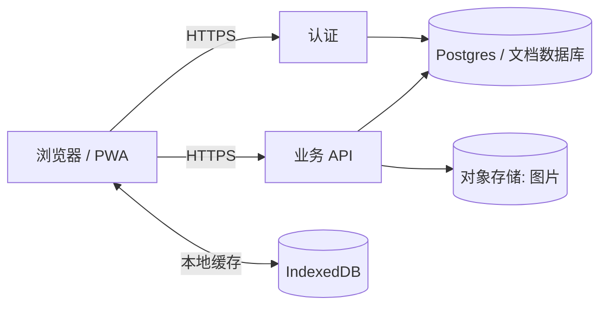

# 多用户 + 多设备卡组同步：原理与方案

> 目标：不同用户登录后看到自己的卡组；同一用户在不同设备上看到同一份内容。  
> 本文只讲原理和选型，不涉及具体实现。

---

## 1. 先回答：需要买服务器吗？

**不需要“买一台物理服务器”，但需要一个后端服务。**

| 需求 | 是否需要后端 |
| --- | --- |
| 只在一台电脑用 | 不需要，继续 localStorage / 文件 |
| 自己多台设备同步 | 需要“存储 + 同步”，可以是最轻的网盘/WebDAV，也可以是后端 |
| 不同用户各自有卡组 | 需要账号、鉴权、数据隔离，必须有后端 |
| 用户之间分享卡组 | 需要后端或至少一个共享存储 |
| 公开只读示例 | 不需要，静态页面即可 |

“买服务器”只是后端的一种形式：

- **托管后端（BaaS）**：Supabase、Firebase、Cloudflare，不用自己买机器；
- **VPS**：一台 5–20 美元/月的云主机，自己部署；
- **Serverless**：Workers/函数 + 托管数据库，按量付费；
- **纯静态 + 网盘**：只适合自己用，不适合多用户。

**关键不是“有没有服务器”，而是“有没有一个可信的地方做账号和数据隔离”。**

---

## 2. 总体架构



前端仍然可以是现在的静态页面，部署在 GitHub Pages / 自有域名 / CDN。  
新增的是：

1. **账号系统**：我是谁；
2. **数据库**：每个用户的卡组和进度；
3. **对象存储**：图片，不再塞进 Data URL；
4. **同步接口**：拉取变更、上传变更、处理冲突。

---

## 3. 账号与数据隔离

### 3.1 用户表

```text
users
  id            uuid
  email         text unique
  password_hash text        -- 或只用 OAuth，不存密码
  created_at    timestamptz
  deleted_at    timestamptz
```

### 3.2 每条数据都带 owner

```text
decks
  id          uuid
  owner_id    uuid -> users.id
  title       text
  mode        short | long
  visibility  private | unlisted | public
  revision    bigint
  updated_at  timestamptz
  deleted_at  timestamptz
```

```text
cards
  id          uuid
  deck_id     uuid -> decks.id
  position    int
  data        jsonb       -- 题干、答案、题型、选项、图片 asset id
  updated_at  timestamptz
```

```text
progress
  user_id     uuid
  deck_id     uuid
  card_id     uuid
  state       jsonb       -- step/ease/due/reps/lapses
  updated_at  timestamptz
```

```text
assets
  id          uuid
  owner_id    uuid
  deck_id     uuid
  object_key  text        -- S3/R2 里的路径
  mime        text
  bytes       bigint
```

### 3.3 隔离靠什么

- **API 层**：从登录 token 得到 `user_id`，永远不要相信前端传的 `owner_id`；
- **数据库行级安全（RLS）**：`auth.uid() = owner_id`；
- **对象存储策略**：只能读写自己前缀下的对象；
- **分享表**：

```text
deck_shares
  deck_id   uuid
  user_id   uuid
  role      viewer | editor
```

公开只读分享可以用 `visibility=public` + 只读接口，或一个随机 `share_token`。

> 如果只在前端判断“这是不是我的卡组”，没有任何安全作用。

---

## 4. 同步的基本原理

### 4.1 本地优先

即使有了后端，前端仍然保留本地缓存：

- 打开应用先读 IndexedDB，立即显示；
- 后台拉取云端变更；
- 用户操作先写本地，再进“待同步队列”；
- 网络恢复后批量上传。

这样断网也能复习，不会因为接口慢而卡。

### 4.2 拉取

不要每次全量下载。给每个用户一个递增的 `sync_cursor`：

```http
GET /sync?since=12345
```

返回：

```json
{
  "cursor": 12352,
  "decks": [ ... ],
  "progress": [ ... ],
  "deleted": [ ... ]
}
```

服务端记录 `updated_at` 或自增序列；客户端只取 `since` 之后的变更。

### 4.3 推送

```http
POST /sync
{
  "operations": [
    { "op": "deck.update", "id": "...", "baseRevision": 7, "data": {...} },
    { "op": "progress.update", "deckId": "...", "cardId": "...", "state": {...} },
    { "op": "review.append", "eventId": "...", "grade": 2, "at": "..." }
  ]
}
```

每个操作带一个客户端生成的 `operationId`，服务端去重，防止重试导致重复。

### 4.4 删除

不要物理删除，先用 `deleted_at` 软删除，并同步“墓碑”。  
否则 A 设备删了卡组，B 设备下次同步又把它推回来。

---

## 5. 冲突处理

多设备同时改同一份数据一定有冲突。要按数据类型分开处理。

### 5.1 卡组内容（标题、卡片）

推荐：**乐观锁 + 版本号**。

- 客户端提交时带 `baseRevision`；
- 服务端当前 `revision` 不等于 `baseRevision`，返回 `409 Conflict`；
- 客户端提示：
  - 保留云端；
  - 用本地覆盖；
  - 另存为副本；
  - 或展示差异让用户合并。

不要在客户端用时间戳判断“谁更新”，设备时钟不可靠。

### 5.2 学习进度

推荐：**按卡片合并**，不要整份进度覆盖。

- `progress` 以 `(user_id, deck_id, card_id)` 为键；
- 每张卡有 `updated_at`/`revision`；
- 两台设备都复习了不同卡片 → 合并；
- 同一张卡都被复习 → 按服务端接收顺序取最后一次，或保留两条 review event。

更稳的做法是**追加复习事件**：

```text
review_events
  id         uuid
  user_id    uuid
  deck_id    uuid
  card_id    uuid
  grade      int
  reviewed_at timestamptz
```

事件只追加、不覆盖；统计从事件算，卡片状态取每张卡最新事件。  
代价是数据量更大，需要定期聚合。

### 5.3 图片

- 图片先上传对象存储，得到 `asset_id`；
- 卡组只存 `asset_id`，不同步大 Base64；
- 删除卡组时异步清理无引用 asset；
- 分享时用签名 URL 或公开只读 URL。

### 5.4 离线编辑

- 本地保存“基线版本 + 本地修改”；
- 上线后先拉取，再尝试推送；
- 冲突时不要静默覆盖，给用户选择。

---

## 6. 图片存储

现在图片是 Data URL 内嵌在卡组 JSON 里。多用户方案应改为：

```text
客户端压缩 -> 申请上传 URL -> 直传对象存储 -> 得到 asset_id -> 卡组只存 asset_id
```

好处：

- 数据库行不会变成几 MB；
- 可以 CDN 加速；
- 可以生成缩略图；
- 可以限制单用户配额；
- 导出时再打包成 ZIP/JSON。

对象存储可选：

- Supabase Storage；
- Cloudflare R2；
- AWS S3；
- 阿里云 OSS / 腾讯云 COS。

---

## 7. 分享与公开卡组

三种可见性：

| 可见性 | 谁能看 | 用途 |
| --- | --- | --- |
| `private` | 只有 owner | 默认 |
| `unlisted` | 有链接的人 | 私下分享 |
| `public` | 所有人 | 公开示例/课程 |

分享模式：

- **只读链接**：`/s/<token>`，不能改；
- **复制到自己的卡组**：复制一份，后续改自己的；
- **协作编辑**：`deck_shares` 加 editor，需要冲突处理。

长期/短期卡组可以保留为业务字段：

- `mode=long` 时服务端拒绝内容更新（如果确实想强制只读）；
- `mode=short` 允许编辑，并受数量上限约束；
- 上限也应由服务端校验，不能只靠前端。

---

## 8. 安全与隐私

如果做多用户后端，你从“本地工具作者”变成“数据控制者”。

必须考虑：

- **HTTPS**：全站强制；
- **密码**：Argon2id/bcrypt，绝不明文；优先 OAuth/ magic link；
- **会话**：HttpOnly Cookie 或短期 access token + refresh token；
- **CSRF**：Cookie 方案要防；
- **速率限制**：登录、注册、导入、上传；
- **权限测试**：A 用户不能读 B 用户；
- **对象存储签名 URL**：不要公开 bucket；
- **服务端密钥**：service role key 绝不能进前端；
- **备份**：数据库每日备份，定期恢复演练；
- **删除账号**：级联删除卡组、进度、图片；
- **隐私政策**：收集什么、存多久、谁能看；
- **内容版权**：课程资料公开分享可能涉及版权。

### 端到端加密（可选）

- 客户端用口令派生密钥，加密卡组后上传；
- 服务端只存密文；
- 优点：服务端泄露也看不到内容；
- 代价：忘记口令无法恢复、分享复杂、多设备要传密钥、搜索困难。

如果只是防“服务器管理员”，E2E 有意义；如果防“共用电脑”，E2E 在解锁后也防不住。

---

## 9. 选型对比

| 方案 | 要不要买服务器 | 开发量 | 适合 | 备注 |
| --- | --- | --- | --- | --- |
| **Supabase** | 不用 | 低–中 | 最推荐的小型多用户 | Postgres + Auth + Storage + RLS |
| **Firebase** | 不用 | 低 | 快速原型、离线 SDK | NoSQL，供应商锁定 |
| **Cloudflare Workers + D1 + R2** | 不用 | 中 | 边缘部署、成本低 | 需要自己写 API/Auth |
| **VPS + Postgres + S3** | 要（$5–20/月） | 高 | 完全可控、长期 | 要自己运维、备份、安全 |
| **GitHub Pages 纯静态** | 不用 | 低 | 单机/示例 | **不能做多用户同步** |
| **GitHub 仓库当存储** | 不用 | 低 | 个人备份 | 不适合多用户/隐私数据 |
| **网盘/WebDAV/Syncthing** | 不用 | 低 | 自己多设备 | 无账号隔离、冲突弱 |
| **P2P/WebRTC** | 仍需信令 | 高 | 实验 | 设备需同时在线，不可靠 |

> 价格以官网为准；免费额度通常够几十到几百用户，增长后按量付费。

---

## 10. 成本粗算

| 项目 | 大致成本 |
| --- | --- |
| 域名 | ¥60–100/年（可选） |
| Supabase/Firebase 免费档 | ¥0，有限额 |
| 小规模付费档 | 约 $25/月起（以官网为准） |
| VPS | $5–20/月 |
| 对象存储 | 几美分–几美元/GB/月 |
| 备份/监控 | 另算 |

对“自己和少数朋友用”，托管后端免费档通常足够。  
对“公开给很多用户”，需要认真算存储、带宽、备份和合规成本。

---

## 11. 推荐路线

### 阶段 1：仍然本地优先

- 保留 localStorage/IndexedDB；
- 继续支持导出/导入；
- 不登录也能用。

### 阶段 2：可选账号 + 云同步

- 用 Supabase：
  - Auth 做邮箱/OAuth；
  - Postgres 存 decks/cards/progress；
  - Storage 存图片；
  - RLS 做用户隔离；
- 登录后把本地卡组“上传到云端”；
- 本地继续缓存，离线可用；
- 冲突先做“整卡组版本号 + 409 提示”，进度按卡片合并。

### 阶段 3：分享与协作

- 只读分享链接；
- 复制到自己的卡组；
- 协作编辑（如果需要）。

### 阶段 4：规模化

- 图片 CDN/缩略图；
- 进度事件聚合；
- 监控、备份、限流；
- 按需迁移到自建 API。

---

## 12. 如果只是“我自己多设备”

可以不买服务器：

1. **导出/导入**：最土但最稳；
2. **网盘同步文件**：把加密后的 JSON 放 iCloud/OneDrive/坚果云；
3. **Syncthing/WebDAV**：设备间同步文件夹；
4. **私有 Git 仓库**：手动提交，不适合频繁复习进度。

这些方案没有账号隔离，也不适合多用户，但成本最低。

---

## 13. 常见坑

1. **把数据库密码/Service Role Key 写进前端**：等于公开；
2. **只在前端判断 owner**：越权；
3. **用客户端时间戳做冲突判断**：设备时钟不可靠；
4. **整份进度覆盖**：两台设备互相丢进度；
5. **物理删除**：另一台设备同步后又推回来；
6. **图片存数据库行**：行变大、备份变慢；
7. **没有限流**：登录/导入/上传被刷；
8. **没有备份**：数据库挂了全没；
9. **忘记删除账号/导出**：隐私合规问题；
10. **把公开分享当私有**：`public` 就是所有人可见。

---

## 14. 一句话

**多用户 + 多设备 = 账号 + 数据库 + 对象存储 + 同步协议。**  
不一定要买服务器：Supabase/Firebase 这类托管后端可以让你只写前端和少量后端逻辑；但纯静态页面做不到。  
如果只是自己用，导出/网盘/Syncthing 更省；如果要给不同用户用，后端是必需的。
